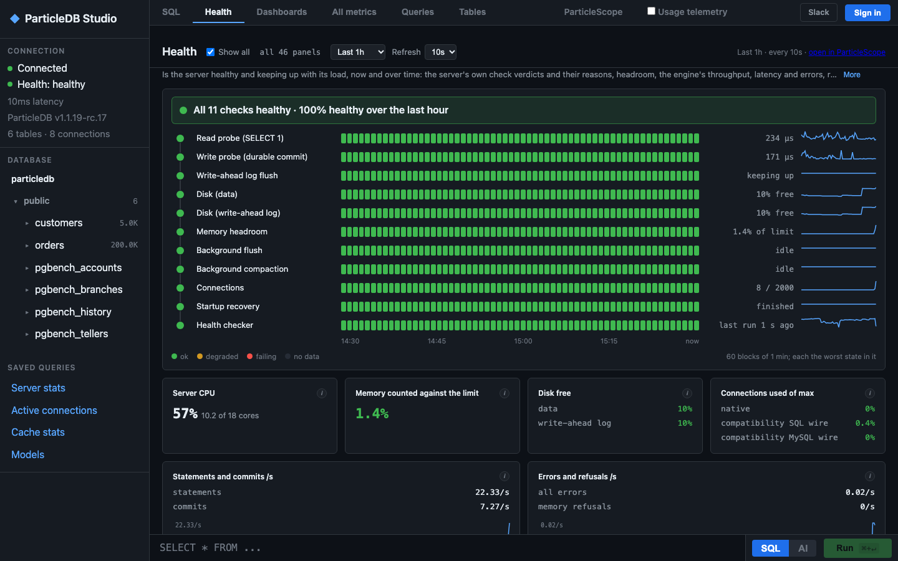
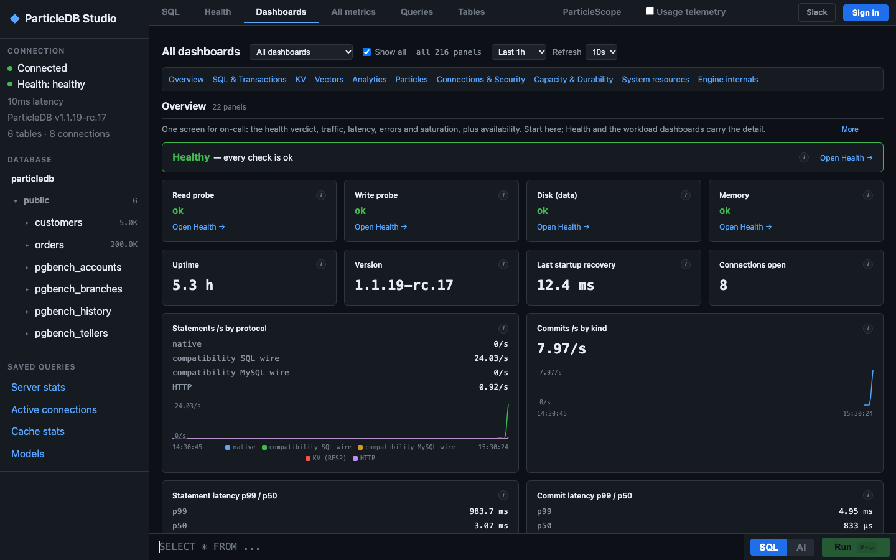

# ParticleDB

The database for AI agents: SQL, vector memory, key-value and live analytics in one engine.

- One server, one port (7173) for the native protocol, PostgreSQL clients, HTTP/JSON, gRPC and Redis (RESP) clients.
- ParticleDB Studio, a web console with a SQL editor, dashboards and health checks, on port 7174.

This repository holds install instructions and links. The server source code is not published; see [License](#license).

## Install

macOS (Apple silicon and Intel) and Linux (x86_64 and arm64):

```bash
curl -fsSL https://get.particledb.ai | bash
particledb --version
```

Each binary is downloaded with a SHA-256 checksum, and the installer refuses a binary whose checksum does not match. Manual downloads, Docker and supported platforms: https://particledb.ai/installation/binary/

## Start a local server

```bash
particledb start --data-dir ./pdb-dev --no-auth
```

`--no-auth` turns authentication off: use it only on a trusted local machine. Then:

| What | Address |
|---|---|
| Clients (native, PostgreSQL, HTTP, gRPC, Redis) | `127.0.0.1:7173` |
| ParticleDB Studio | http://127.0.0.1:7174 |

## ParticleDB Studio

Studio, the web console at http://127.0.0.1:7174, shows the server's health checks and dashboards.





## First query

With `psql`:

```bash
psql -h 127.0.0.1 -p 7173 -U postgres -d particledb -c "SELECT 1"
```

Over HTTP:

```bash
curl --fail-with-body http://localhost:7173/v1/sql \
  -H 'Content-Type: application/json' \
  -d '{"sql":"SELECT 1"}'
```

Full walkthrough: https://particledb.ai/getting-started/quickstart/

## Client libraries

All SDKs are MIT licensed.

| Language | Package | Source |
|---|---|---|
| Python | `pip install particledb` | [particledb-python](https://github.com/particledb-ai/particledb-python) |
| TypeScript / JavaScript | `npm install @particledb/sdk` | [particledb-typescript](https://github.com/particledb-ai/particledb-typescript) |
| Go | `go get github.com/particledb-ai/particledb-go` | [particledb-go](https://github.com/particledb-ai/particledb-go) |
| Rust | `cargo add particledb-sdk` | [particledb-rust](https://github.com/particledb-ai/particledb-rust) |
| Java | `ai.particledb:particledb-java-sdk` (Maven Central) | [particledb-sdk-java](https://github.com/particledb-ai/particledb-sdk-java) |
| JDBC | `ai.particledb:particledb-jdbc` (Maven Central) | [particledb-jdbc](https://github.com/particledb-ai/particledb-jdbc) |

Existing PostgreSQL drivers and Redis clients also connect to port 7173.

## Documentation

https://particledb.ai/docs/

## Help and feedback

- Community Slack: https://particledb.ai/slack/
- Report an issue from ParticleDB Studio: select **Report an issue** in the top bar. Reports go to the ParticleDB team privately and can include diagnostics with secrets redacted.

## Correctness testing

ParticleDB is tested with Jepsen. The findings from the Jepsen analysis of ParticleDB 1.1.4 and their status are tracked publicly at https://github.com/particledbai/jepsen. The Jepsen test harness for ParticleDB is at https://github.com/jepsen-io/particledb.

## Security

Report a security problem privately to privacy@orkes.io. Do not open a public issue.

## License

The ParticleDB server, including the free edition, is proprietary software of Orkes, Inc. and is used under the ParticleDB License: https://particledb.ai/license/. The SDKs and client libraries are MIT licensed.

Privacy policy: https://particledb.ai/privacy/
